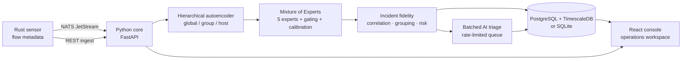

# AttackSentry

**On-premises Network Detection & Response for security operations teams.**

AttackSentry learns the normal behavior of a network, attributes anomalous flows with
a calibrated Mixture-of-Experts model, correlates detections into a low-noise incident
queue, and produces auditable investigation playbooks. It is designed for local-first,
air-gapped, and regulated environments: L3/L4 metadata only, no payload capture, and
no dependency on a cloud control plane.

<p>
  
  
  
</p>

## Why AttackSentry

Most NDR tools either produce a flood of raw anomalies or hide attribution behind a
closed model. AttackSentry keeps the evidence chain open:

- **Environment-aware detection.** Global, subnet, and host autoencoders learn what is
  normal for this deployment, not a generic baseline.
- **Calibrated attribution.** Five specialist experts and a LightGBM gating network
  produce one calibrated attack probability and a stable attack family.
- **Incident-level signal.** Detections are correlated by target/source scope and
  canonical family; a DDoS campaign against one host is one case, not hundreds of alerts.
- **Batched AI triage.** One evidence dossier per incident, rate-limit aware, with a
  deterministic fallback when the model is unavailable.
- **Framework context.** Every detection carries NIST CSF 2.0, ISO/IEC 27001:2022,
  OWASP Top 10, and MITRE ATT&CK context for review and reporting.
- **Auditable response.** Containment is a policy decision with target, reason,
  approver, expiry, and provider outcome recorded.
- **Operator console.** Dense tables, evidence drill-down, MITRE mapping, IAM, sensors,
  suppression policy, and reports in one workspace.

## Detection results

The shipped MoE bundle (`20260820-150548`) reaches an F1 of **0.9967** on balanced held-out
data and **0.9898** on a deployment-like 95/5 split, with precision **0.9834** and recall
**0.9962** at a threshold selected for ≤0.1% false positives. The chart shows the same
evaluation per attack group. Botnet/C2 recall (0.327) is the known weak point; the gating
network limits its operational impact, and it is the first target for the next model
iteration. In integration testing, all 21 known simulator scenarios and all 3 zero-day
behaviours produced incidents.

## Architecture



The sensor emits 28 base features; the core derives 14 ratios into the canonical
42-feature vector used by both training and inference.

## Quick start

### Docker Compose (recommended)

Requirements: Docker Engine 24+, Docker Compose v2, 8 GB RAM.

```bash
chmod +x attacksentry.sh
./attacksentry.sh start
```

The first run generates database, NATS, JWT, and administrator credentials, prints the
one-time admin password, and starts the console at <http://localhost:8080>.

```bash
./attacksentry.sh status
./attacksentry.sh logs
./attacksentry.sh doctor
./attacksentry.sh stop
```

### Local development

```bash
python3 -m venv .venv && source .venv/bin/activate
pip install -r Sentry/requirements.txt
cd UI/frontend && npm install && cd ../..
./start_all.sh
```

`start_all.sh` starts llama.cpp (OpenAI-compatible), the backend, and the Vite dashboard,
then prints the dashboard URL and the admin username/password from `Sentry/.env`. It uses
`SENTRY_LLAMA_MODEL` if set, otherwise the local Qwen3.5-2B GGUF, and falls back to
deterministic playbooks if `llama-server` or the model is unavailable.

Run the attack simulation from a second terminal:

```bash
./scripts/attack_sim.sh                              # baseline + all known + zero-day
./scripts/attack_sim.sh --skip-baseline --scenario zero-day
```

- Console: <http://localhost:5173>
- API docs: <http://localhost:8000/api/docs>
- Health: `/healthz`, `/readyz` · Metrics: `/metrics`

The first run creates the administrator from `SENTRY_BOOTSTRAP_ADMIN_PASSWORD` in
`Sentry/.env`. Start in **monitoring** mode, let the baseline learn, then the engine
trains and switches to **active** automatically. For a quick demo, set
`SENTRY_BASELINE_HOURS=0.05` or feed benign traffic with `scripts/demo.py`.

### Sensor

Linux requires libpcap; Windows requires Npcap. Register the sensor in
**Settings → Sensors**, download the non-secret environment template, then:

```bash
sudo setcap cap_net_raw,cap_net_admin=eip ./attacksentry-sensor
SENTRY_TEST_CONNECTION=1 SENTRY_NATS_URL=nats://127.0.0.1:4222 \
SENTRY_NATS_USERNAME=attacksentry SENTRY_NATS_PASSWORD='<generated>' \
./attacksentry-sensor          # prints CONNECTED, or FAILED and exits 2

SENTRY_HEADLESS=1 SENTRY_DEVICE=eth0 ./attacksentry-sensor
```

## Configuration

All backend settings use the `SENTRY_` prefix. The full reference is in
Deployment configuration. The settings that matter most:

| Variable | Default | Purpose |
|---|---|---|
| `SENTRY_SECRET_KEY` | dev placeholder | JWT/cookie signing key (≥32 chars in production) |
| `SENTRY_BOOTSTRAP_ADMIN_PASSWORD` | generated | First-run admin password |
| `SENTRY_DATABASE_URL` | SQLite | PostgreSQL + TimescaleDB in production |
| `SENTRY_NATS_URL` | empty | Enables NATS ingestion; REST always works |
| `SENTRY_BASELINE_HOURS` | `72` | Learning window before auto-training |
| `SENTRY_LLM_PROVIDER` | `openai` | `lmstudio`, `ollama`, `auto`, `openai`, `groq`, `none` |
| `SENTRY_LLM_BATCH_WINDOW_SECONDS` | `3` | Debounce evidence per incident |
| `SENTRY_LLM_MAX_CONCURRENCY` | `2` | Bounded AI workers |
| `SENTRY_RESPONSE_MODE` | `disabled` | `approval` or `automatic` containment |

Runtime-tunable values can also be changed from the console and are persisted in the
database; environment values remain the restart-safe defaults.

## API

The REST API is documented at `/api/docs`.
WebSocket feeds: `/ws/telemetry`, `/ws/traffic`, `/ws/alerts`, `/ws/incidents`.

Sensor ingestion uses `POST /api/ingest/flow` with `X-Sentry-Key-ID` and
`X-Sentry-Secret`. User sessions use httpOnly JWT cookies.

## Security

- L3/L4 flow metadata only; no packet payloads or TLS decryption.
- bcrypt passwords, httpOnly/SameSite cookies, three roles, last-admin protection.
- Hashed sensor API keys; secrets are returned once.
- Pseudonymised entities before external LLM triage by default.
- HMAC-signed webhook delivery, explicit approval mode, expiry/release lifecycle.
- Timescale retention policies and a SQLite retention task.
- Audit log for administrative actions and response decisions.

The threat model and hardening checklist live with the deployment manifests.

## Simulation

```bash
# clean corporate baseline (finance, engineering, sales, data-center, IoT)
python scripts/attack_scenarios.py --fresh-baseline

# all known families + three zero-day behaviours
python scripts/attack_scenarios.py --skip-baseline --scenario all --count 20

# zero-day only, or list expected attribution
python scripts/attack_scenarios.py --scenario zero-day --count 20
python scripts/attack_scenarios.py --list-scenarios
```

The script reports detected incidents, correlated signals, observed family, and
whether each zero-day behaviour produced a `Behavioral Anomaly` signal.

## Testing

```bash
cd Sentry && ../.venv/bin/python -m pytest tests -q
cd UI/frontend && npx tsc --noEmit && npx vitest run && npm run build
cd sentry_sensor && cargo test --all-targets && cargo build --release
NATS_PASSWORD=validation-only docker compose -f deploy/docker-compose/docker-compose.yml config --quiet
```

CI runs the backend suite (30 tests), frontend typecheck/tests/build, and the Rust
sensor build on every pull request.

## Repository layout

```
AttackSentry/
├── Sentry/                 Python core, API, migrations, model bundle, tests
├── UI/frontend/            React console (Vite, Tailwind, TanStack Query, Zustand)
├── sentry_sensor/          Rust capture agent (headless + optional GUI)
├── deploy/                 Docker Compose, Helm, systemd
├── scripts/                Demo traffic, attack simulator, release packaging, migration helpers
├── attacksentry.sh/.ps1    Platform launcher
└── start_all.sh            Development startup
```

## Operations

- **Health:** `/healthz`, `/readyz`, `/api/diagnostics` (admin)
- **Backups:** database plus `Sentry/data/` (baselines and model state)
- **Upgrades:** Alembic runs automatically; review release notes for schema changes
- **Scale:** one stateful backend replica; scale ingest with sensors and NATS
- **Air-gapped:** pre-pull images, use a local LLM or `SENTRY_LLM_PROVIDER=none`

## Contributing

Keep changes scoped, run the test matrix above, and update this README when a
behavior or configuration changes.

## License

Proprietary. See [LICENSE](LICENSE). The included demo scripts generate synthetic
telemetry; no customer or production data ships with this repository.
